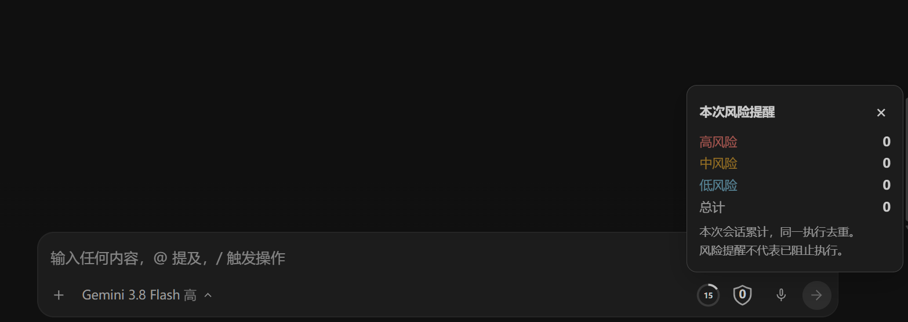
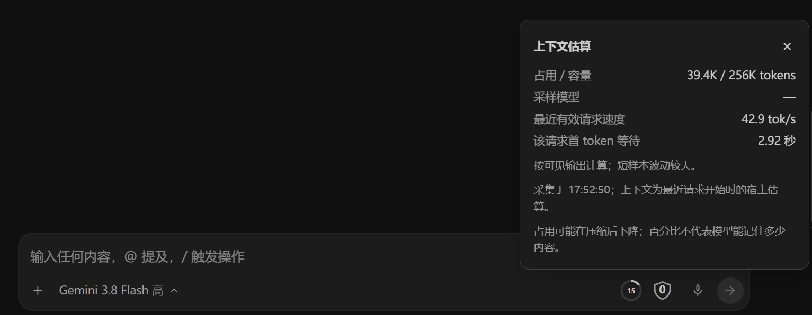

<p align="center">
  
</p>

<h1 align="center">EasyAG · 把准备工作交给启动器</h1>

<p align="center">免 TUN 代理 · 实时汉化 · Turbo Pilot · ARES 风险提醒</p>
<p align="center">
  <a href="#快速上手">快速上手</a> ·
  <a href="docs/PORTABLE.md">便携版说明</a> ·
  <a href="#反重力账号与登录指南">账号与登录指南</a> ·
  <a href="https://github.com/DSDS-CMHL/EasyAntigravity/issues">反馈问题</a>
</p>

---

你只想让 Antigravity 顺畅干活，而不是每次启动都要配置网络代理、到处找汉化补丁、还要为 Agent 的每一步终端命令频繁点击“允许”。

**EasyAG 是专为 Antigravity 桌面端打造的增强启动器**：
- **启动前**：自动接通代理环境、加载中文汉化与智能安全规则。
- **启动后**：自动缩进托盘，把屏幕完整留给 AG。
- **运行中**：日常无害命令自动执行，遇到真正危险的操作时精准预警，并在输入框旁安静显示上下文占用。

> **提示**：EasyAG 不是独立的聊天客户端，不会替代 AG，也不会替你盲目点击“允许执行”。

---

## 界面一览

<p align="center">
  
</p>

填入代理端口、勾选汉化与模式，点击即可一键启动 AG。无需繁琐配置，随开随用。

---

## 核心特性

### 1. Turbo Pilot：日常命令免审批，危险命令精准提醒

每次跑命令都要手动点确认？开启 **Turbo Pilot** 模式后，常见的开发命令会自动放行；一旦遇到危险操作，依然会触发 **AG 原生审批流程**，并由 ARES 解释潜在风险。

它不是盲目“全部信任”，而是把精力留给真正关键的确认节点。

内置三档防护强度，可按需选择：

| 防护强度 | 适用场景 |
| --- | --- |
| **标准（推荐）** | 识别绝大多数危险命令与高危参数，在安全与流畅之间取得最佳平衡。 |
| **严格** | 进一步扩大高危模式的匹配范围（如各种递归删除、强制推送），宁可多报、绝不漏报。 |
| **宽松** | 仅拦截极端破坏性操作（如清空磁盘、系统级关键目录删除），最大程度减少打扰。 |

*注：档位只控制 EasyAG 的预设规则，你在 AG 内自行添加的自定义规则不受影响。档位需在退出 AG 后切换，下次启动生效。*

---

### 2. 兼容模式：只做代理与汉化，不触碰任何权限

如果你习惯原汁原味的确认机制，或者已经有自己的一套规则，只需在启动器中选择**兼容模式**。

该模式下**不注入 Pilot 规则、不修改自动执行策略、不开启 ARES 风险提醒**，仅提供网络代理与汉化支持。

---

### 3. ARES 风险雷达：不仅告诉你危险，还讲清楚后果

<p align="center">
  
</p>

很多时候，一句抽象的“危险命令”根本无法帮人做决定。ARES 会明确标出**风险等级、命中的具体命令，以及可能造成的实际后果**——比如是会清空指定目录、覆写远程 Git 历史，还是执行了外部未知脚本。

弹窗提醒只负责告知风险，命令是否最终执行，决定权始终在你的原生审批窗口中。

---

### 4. 输入区状态指示：一眼看清上下文与风险

不用来回切换启动器看后台，关键信息直接常驻在 AG 的输入区：

<p align="center">
  
  &nbsp;&nbsp;&nbsp;&nbsp;
  
</p>

- **上下文圆环**：直观展示当前对话的 Token 与上下文占用比例，点击可查看模型名称、剩余容量等详情。
- **风险盾牌**：颜色跟随最近一次命中的风险级别（高/中/低），数字显示本次会话累计触发的风险次数（超过 99 次显示 `99+`），点击可展开高/中/低各级别的详细统计。

---

### 5. 纯净无侵入：临时叠加，用完即还

EasyAG 严格遵循**不破坏原配置**的原则：
- **退出即还原**：启动时只以附加形式写入必要的防护规则，正常退出 AG 时自动撤销 EasyAG 注入的内容，完整保留你的原始配置与在 AG 界面中自行新增的规则。
- **不改安装包**：汉化与界面增强通过官方支持的 CDP 调试接口动态接入，无需对官方安装文件进行任何破解或替换。

---

## 快速上手

1. **解压运行**：在 [Releases 发布页面](https://github.com/DSDS-CMHL/EasyAntigravity/releases) 下载最新便携包，**解压到独立文件夹**后运行 `EasyAntigravity.exe`（请勿将单个 exe 移出解压目录）。
2. **连接代理**：打开你的代理客户端，在 EasyAG 中填入对应的 **HTTP / Mixed 本地端口**（如 7890、10809 等，EasyAG 本身不提供节点）。
3. **一键启动**：按需勾选汉化与模式，点击“启动”即可进入 Antigravity！（若 AG 已经在运行，请先完全退出）。

> **说明**：
> - Windows 版已内置独立 Node 运行环境，无需额外配置开发环境；系统需支持 WebView2（Win10/11 默认已自带）。
> - 关闭 EasyAG 主窗口会自动最小化到系统托盘，彻底退出请在托盘图标右键选择“退出应用”。

---

## 反重力账号与登录指南

如果你在使用 Antigravity 过程中遇到账号注册、登录受限、网络报错等问题，可以参考这份社区整理的详细指南：

👉 **[Antigravity 账号登录与常见问题指南（飞书知识库）](https://zcn91ppq6ur7.feishu.cn/wiki/L748wAHTriwwGVkc7TSc3TSennb)**

涵盖了账号准备、环境要求、登录失败排查及日常使用技巧。交流与讨论也欢迎前往 [linux.do](https://linux.do) 论坛。

---

## 常见问题

**Q: 启动后 AG 界面为什么显示“自定义”，而不是“Turbo”？**  
A: 因为 EasyAG 是将原生的命令自动执行策略与精细化的审批规则组合生效的。在官方界面中，这种定制组合会被标注为“自定义”，这代表增强规则已成功挂载。

**Q: 修改或添加了规则之后，需要重启 AG 吗？**  
A: 在 Pilot 运行期间，直接在启动器中点击“重载规则”即可即时生效，无需重启 AG。

**Q: 它能防御所有危险命令吗？**  
A: 不能。ARES 是基于规则模式与语义特征的辅助提醒工具，不是绝对沙箱或反病毒引擎。对于核心代码库或重要生产环境，涉及高危操作时请务必自行核对命令与目标路径。

**Q: 支持 AG IDE 或 CLI 命令行版本吗？**  
A: 目前专注于 Antigravity 桌面客户端，暂未适配 IDE 与纯 CLI 场景。

---

## 开发与文档

EasyAG 基于 Tauri（Rust）+ 模块化 Node.js + 原生 Web 前端构建。

```sh
npm ci          # 安装开发依赖
npm start       # 启动开发调试
npm run check   # 代码规范校验
npm test        # 运行测试套件
```

| 进阶文档 | 详细内容 |
| --- | --- |
| [架构设计](docs/ARCHITECTURE.md) | 模块拆分、运行机制与生命周期 |
| [规则引擎与 ARES](docs/RULES.md) | 规则匹配语法与风险知识库说明 |
| [防护强度机制](docs/防护强度机制.md) | 严格 / 标准 / 宽松的具体边界与正则覆盖 |
| [上下文监控](docs/上下文监控.md) | Token 占用估算与界面挂载原理 |
| [v3.2 更新说明](docs/RELEASE-v3.2.md) | 本阶段功能演进与实测说明 |

---

## 致谢

- 汉化词典主要来源于：[nicktan @ linux.do](https://linux.do/t/topic/2896116)。
- 上下文与输入区指标展示参考了 [Antigrative Dashboard / AG Pulse](https://github.com/YOU-SHOULD-KNOW-ME/antigrative-dashboard) 的设计与实现（MIT 协议）。

*免责声明：Antigravity 为 Google 旗下产品，EasyAG 为独立的开源社区增强项目，与 Google 官方无关。*

[MIT License](LICENSE)
