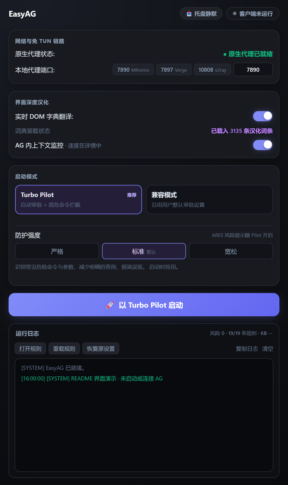
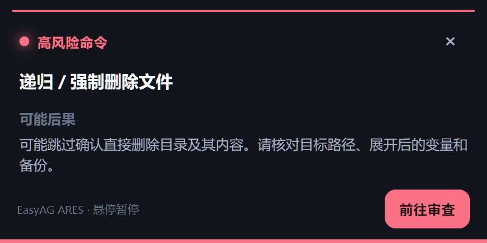
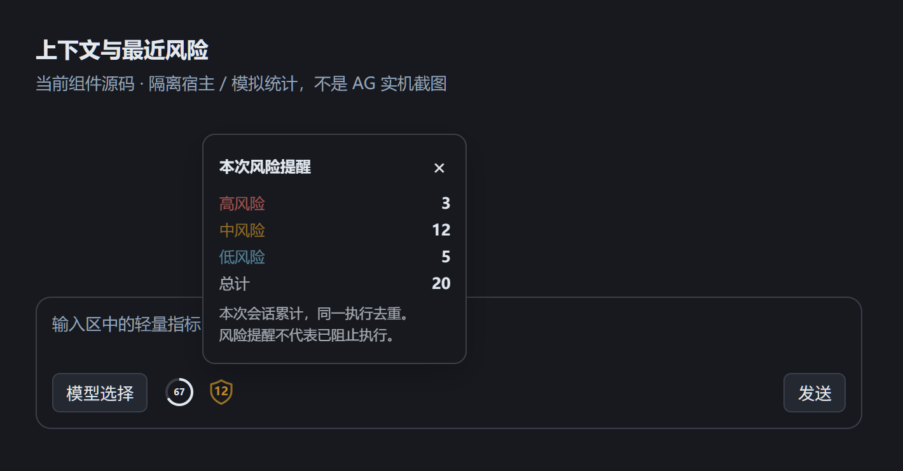

<p align="center">
  
</p>

<h1 align="center">EasyAG · 把准备工作交给启动器</h1>

<p align="center">免 TUN 代理 · 实时汉化 · Turbo Pilot · ARES 风险提醒</p>
<p align="center">
  <a href="https://github.com/DSDS-CMHL/EasyAntigravity/actions/workflows/tauri-ci.yml">下载构建</a> ·
  <a href="#三步开始">快速开始</a> ·
  <a href="docs/PORTABLE.md">便携版说明</a> ·
  <a href="https://github.com/DSDS-CMHL/EasyAntigravity/issues">反馈问题</a>
</p>

你想让 Agent 把事情做完，而不是反复配置代理、找中文设置、为每一步点确认。

EasyAG 是 **Antigravity 桌面端的增强启动器**：启动前准备连接与权限，启动后收起到托盘。你继续在 AG 里工作；需要关注上下文或风险时，轻量指标和通知再出现。

**它不替代 AG，也不替你点击“允许”。**

## 一眼看看

<p align="center">
  
</p>

选择代理端口、汉化和启动模式，一键进入 AG。不需要在 EasyAG 里维护另一套聊天或任务列表。

截图来自当前前端源码的隔离渲染，使用演示状态，不包含账号或工作区数据。下方指标图为真实组件在模拟宿主中的展示，不是 AG 实机截图。圆润盾牌与 `99+` 上限从 v3.2.4 起提供。

## 一个启动器，两种用法

### Turbo Pilot：少点审批，危险操作再确认

Pilot 把“开启命令自动执行、写入危险命令审批规则”变成一次启动操作。命中规则的命令仍由 **AG 原生审批**处理，ARES 负责解释风险。

它不是“所有操作都安全”，而是让你把注意力放在更值得确认的地方。

| 防护强度 | 适合的取向 |
| --- | --- |
| 严格 | 更宽泛地匹配部分危险文本，接受更多审批和误报。 |
| 标准 · 默认 | 识别常见危险命令与参数，兼顾审批范围和使用体验。 |
| 宽松 | 缩小默认审批范围，保留部分关键高危操作；漏报风险更高。 |

三档调整的是默认规则，用户自定义规则的动作与开关仍保留。运行中不能切换档位，AG 退出后调整，下次启动应用。

### 兼容模式：只增强连接与界面

只想使用代理、汉化，或者已有自己的权限配置？选兼容模式。

**不注入 Pilot 规则、不更改自动执行策略、不启用 Pilot 的 ARES 风险提醒。** 已开启的上下文显示仍可使用。

无论哪种模式，工作区外文件访问与沙箱设置都由你在 AG 内决定。EasyAG 不为追求“Turbo”标签而扩大这些权限。

## 风险提示，要讲后果，而不是只亮红灯

<p align="center">
  
</p>

“危险命令”不足以帮助判断。ARES 会给出**高／中／低等级、命中的操作，以及可能造成什么后果**，例如删掉目录内容、覆盖远端历史或执行来源不明的脚本。

你可以关闭胶囊，或点击“前往审查”回到 AG。是否执行，仍由你在 AG 的审批界面决定。

胶囊通知不是执行门禁，出现提醒不代表命令已经被阻止。v3.2.3 已加入原生窗口不获取输入焦点、审查请求去重及隐藏后再激活 AG 的修复；原生不抢焦点仍待对应构建实机验收。

## 有用的信息，留在 AG 输入区



不用打开启动器看一排仪表。两个小标识就够：

- **上下文圆环**：显示最近请求的上下文占用估算，数字加粗。点击看占用、容量与模型；生成速度作为附带信息放在详情里。
- **最近风险盾牌**：颜色跟随最近一次风险命中的等级，内部显示该等级的会话累计次数。不定时轮播，也不会永远停在历史最高风险。
- **清楚但不挤**：0–99 显示实际数字，100 起显示 `99+`；悬浮与详情保留准确次数。点击可查看高、中、低和总计。

普通命令不会切换风险盾牌；同一次执行不重复计数，切换对话不清零，新 AG 会话重新计数。

上下文数据是估算，容量未知时不伪造百分比，压缩后占用可能下降。我们不另做额度面板，也不把生成速度当作需要一直盯着的指标。

## 增强是临时叠加，不是接管你的设置

Pilot 启动前记录原策略，只登记 EasyAG 自己新增的规则。正常结束会话后撤回这些规则，恢复原策略，**不是把你的配置整份替换成一个“默认模板”**。

你在 AG 界面里后来新增的个人规则，也应该留下来。本轮已实机确认：

- 新增与禁用规则重载能生效。
- 重载后正常退出，包含探针在内的本会话注入全部撤回。
- 运行期间通过 AG GUI 新增的用户规则，退出后保留。
- 兼容模式沿用用户配置。

异常中断后，下次启动会尝试处理恢复记录；**异常退出恢复本轮未做实机验收**。不要手动删除尚未完成恢复的记录。

## 三步开始

1. **完整解压**对应平台的便携包。Windows 运行 `EasyAntigravity.exe`，不要把它单独移出目录。
2. 打开你的代理软件，选择常见端口，或输入实际的 **HTTP／Mixed 端口**。EasyAG 本身不提供代理节点或代理服务。
3. 选择汉化和启动模式，点击启动 AG。已有 AG 正在运行时，先退出，再通过 EasyAG 启动以应用 Pilot 配置。

Windows 包自带 Node.js，无需安装开发环境；界面依赖 WebView2。macOS 的 Apple Silicon／Intel 构建为 Beta。

[前往 GitHub Actions 构建列表](https://github.com/DSDS-CMHL/EasyAntigravity/actions/workflows/tauri-ci.yml)，打开成功完成的构建，在 Artifacts 下载对应平台包。构建附件下载可能需要登录 GitHub。

关闭主窗口会收起至托盘，**不等于退出**；要结束 EasyAG，请使用托盘“退出应用”。升级时完整解压到新目录，避免旧快捷方式仍指向旧版。

## 你可能会问

**AG 为什么显示“自定义”，不是 Turbo？**  
Pilot 使用命令自动执行策略与审批规则的组合，同时保留你的其他权限选择。标签显示自定义不代表增强未开启。

**修改规则以后，必须重启吗？**  
Pilot 运行时可以点击“重载规则”，更新本地识别和 AG 原生权限。仅打开启动器、未启动 Pilot，或处于兼容模式时，重载不会写入 AG 权限。编辑规则时避免同一规则重复存在，一份禁用不会取消另一份启用的副本。

**它能拦住所有危险命令吗？**  
不能。正则有覆盖边界，默认规则仍可能误报、漏报；ARES 不是防病毒软件，也不是沙箱。重要操作仍需检查目标、权限和备份。

**是否支持 AG IDE 或 CLI？**  
当前专注 AG 桌面端，IDE 与 CLI 尚未适配。旧 Hook 执行机制已经移除，不依赖它完成命令拦截。

**会修改 AG 安装文件吗？**  
界面增强通过 CDP 注入，权限增强通过配置叠加；不需要修改 AG 的安装资源。CDP 调试入口应仅限本机，不要暴露到公网。

## 开发与进一步了解

前端是 HTML／CSS／JavaScript，业务后台为模块化 Node.js，Tauri／Rust 负责原生窗口、托盘及后台生命周期。

```sh
npm ci
npm start
npm run check
npm test
```

开发需要 Node.js 22+；原生打包另需 Rust 与 Tauri 构建环境。重新生成本文演示截图：

```sh
node scripts/capture-readme.cjs "<Chromium 可执行文件路径>"
```

截图脚本只启动独立浏览器和演示服务，不启动或连接真实 AG，也不读写用户 AG 配置。

| 想了解什么 | 文档 |
| --- | --- |
| 模块职责与架构 | [总体架构](docs/ARCHITECTURE.md) |
| 原生权限规则与 ARES | [规则说明](docs/RULES.md) |
| 严格／标准／宽松的具体范围 | [防护强度](docs/防护强度机制.md) |
| 上下文与风险指标 | [指标说明](docs/上下文监控.md) |
| 重载与恢复的实机结果 | [验收记录](docs/规则重载与恢复验收.md) |
| 这轮新特性与验证边界 | [v3.2 系列说明](docs/RELEASE-v3.2.md) |

## 致谢

汉化词典主要来源：[nicktan @ linux.do](https://linux.do/t/topic/2896116)。部分桌面发现与组件布局适配参考了 [Antigrative Dashboard](https://github.com/YOU-SHOULD-KNOW-ME/antigrative-dashboard)，第三方声明见 [THIRD-PARTY-NOTICES.md](THIRD-PARTY-NOTICES.md)。

账号相关社区资料：[社区文档](https://zcn91ppq6ur7.feishu.cn/wiki/L748wAHTriwwGVkc7TSc3TSennb)。友链：[linux.do](https://linux.do)。

Antigravity 为 Google 产品，本项目为独立社区项目，与 Google 官方无关。

[MIT License](LICENSE)
